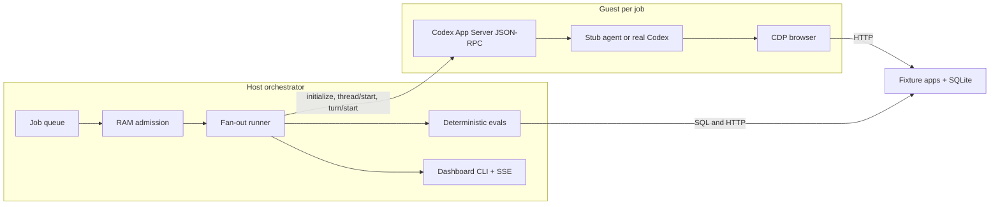

# Browser-use fan-out lab

Training lab for packaging **Codex App Server** inside a guest, fanning browser-use jobs out across those guests, and scoring them with deterministic checks. The lab assumes you already know why a microVM-per-user boundary exists. It does not build a VMM, and it is not a sandbox product.

Browser jobs use CDP (Lightpanda, or Playwright Chromium when that binary is absent). The OSWorld Calc pack is desktop work on the guest VGA screen: LibreOffice Calc, scored from the saved spreadsheet.

## How this differs from OpenShell

NVIDIA OpenShell is a sandbox product: it owns the isolation environment agents run in. This repo is an internal workshop. Isolation is a boundary you already have (microVM per user in production, a process or container per job in the lab). The material here is the stuff that sits on either side of that boundary:

- pin and launch `codex app-server` inside the guest
- give that guest a CDP browser (Lightpanda on `127.0.0.1:9222`)
- on the host, queue job cards, admit guests from a RAM budget, stream `thread/start` / `turn/start`, run evals, tear the guest down

No OpenShell dependency, no public-web scraping, no API key on the stub path.

## Architecture



| Piece | Role |
| --- | --- |
| `apps/fixtures` | Onboarding portal, support desk, booking app. SQLite, seed, `POST /api/reset`. |
| `packages/orchestrator` | Queue, RAM admission, fan-out runner, CLI + HTML/SSE dashboard. |
| `packages/guest-agent` | Mock app-server (`initialize`, `thread/start`, `turn/start`), CDP browser tool, scripted stub agent. |
| `packages/evals` | DB and HTTP checkers. No LLM judge. |
| `tasks/` | Job cards and executable evals. `batch-24.yaml` is the browser fan-out. `tasks/osworld/` mixes LibreOffice Calc and Chrome tasks from OSWorld. |
| `packages/agents-api` | Local Agents API: self-hosted sessions, signed webhooks, executor WebSocket. |
| `drivers/lume` | Default guest. `lume` on Apple Silicon (Virtualization.framework). QEMU on Linux (KVM, or TCG when nested KVM cannot boot). |
| `drivers/process` | Fast path: one Node process per job, stdio JSON-RPC. |
| `drivers/docker` | Neko guest. One container per Agents API session. |
| `drivers/microvm` | Alias of the lume/QEMU driver. |

Production pattern: **one microVM per user**, and that VM contains Codex App Server. This fan-out lab runs **one guest per job** so a single machine can drain a queue of short browser tasks. See [docs/microvm.md](docs/microvm.md) and [docs/architecture.md](docs/architecture.md).

## Mac 24GB budget

Lightpanda guests are small. The defaults in `createDefaultConfig` match a 24GB Apple Silicon machine:

| | |
| --- | --- |
| Machine | 24 GB |
| Reserved for the host (OS, orchestrator, fixtures, dashboard) | 6 GB |
| Left for guests | 18 GB |
| Per Lightpanda guest | 700 MB (the 600–800 MB band) |
| Memory-only ceiling | `floor(18432 / 700) = 26` |
| Lab cap you should actually set | **20–24** concurrent guests |

```bash
./scripts/run-demo.sh --concurrency 20
```

That flag does not require Mac hardware. Here, guests are processes, so do not actually start 20 Chromium instances on a small VM. Use the low-RAM flag instead. It sets a 2000 MB budget and a 600 MB host reserve, which admits **2** guests of 700 MB and leaves the other 22 jobs queued:

```bash
./scripts/run-demo.sh --low-ram --exit
```

The summary prints `peak concurrent guests` and `backpressure events`. Unit tests lock the same math.

## Neko desk

The workshop desktop is Xfce in Docker, streamed by [neko](https://github.com/m1k1o/neko). Chat on the dashboard drives that container. The `lume` / QEMU driver is still the microVM path for the isolation lab; the desk does not boot it.

```bash
./scripts/boot-neko.sh
sudo docker cp scripts/neko/setup-inside.sh workshop-neko:/tmp/setup-inside.sh
sudo docker exec workshop-neko bash /tmp/setup-inside.sh
```

`scripts/boot-neko.sh` starts `workshop-neko` on the host network at [http://127.0.0.1:8341](http://127.0.0.1:8341). Sign in as `neko` / `neko` (admin / `admin`). This machine's dockerd runs with iptables off, so the container uses `--network host` and neko binds `127.0.0.1:8341` directly. WebRTC is ice-lite with a UDP mux on `52100` and a TCP mux on `52151`. `NAT1TO1` is the host address that owns that socket (the default-route IPv4, not `127.0.0.1`: pion does not bind the mux on loopback, so a loopback candidate never answers). Signaling stays on [http://127.0.0.1:8341](http://127.0.0.1:8341).

The dashboard at [http://127.0.0.1:4318](http://127.0.0.1:4318) embeds that desktop next to a chat. A message is planned on the host (phrase matcher, no API key, no model) and executed in the container: Firefox, xfce4-terminal, Thunar, clicks, and keys.

OpenClaw is the fleet bus. One gateway on the host at [http://127.0.0.1:18789](http://127.0.0.1:18789) owns the main chat. Each neko container runs `openclaw node run` against that gateway and publishes a `desk` MCP server (`scripts/neko/desk-mcp.py`). The main chat says `nodes`, `state of workshop-neko`, or `on <container> open the terminal`. A VM sends a line back with `tell main ...` in its chat, or `desk-tell "..."` in the container, which posts to the gateway hook `/hooks/desk`. There is no model key in this lab, so those turns stay on the local planner and the node RPC. `openclaw agent` still needs a provider key before it can think. Bring the gateway and the desk node up with `./scripts/openclaw-up.sh`. New Agents API neko sessions mount `/opt/openclaw` and start a node named after the container.

`scripts/neko/desk-act.py` calls `cua-driver call` for pointer and keyboard, and falls back to xdotool when the daemon does not answer. The QEMU wall, when guests are booted, is [http://127.0.0.1:4318/vms](http://127.0.0.1:4318/vms).

Cua Driver is installed for the `neko` user. `cua-driver serve` runs in that session on `DISPLAY=:99.0`. Codex talks to it through the host wrapper, which is `docker exec -i` of `cua-driver mcp` inside the container. The project config is `.codex/config.toml`:

```toml
[mcp_servers.cua-driver]
command = "/workspace/scripts/neko/cua-driver-mcp.sh"
```

With the `codex` CLI on `PATH`, the same registration is `codex mcp add cua-driver -- /workspace/scripts/neko/cua-driver-mcp.sh`. Copy `.codex/config.toml` to `~/.codex/config.toml` if you want it user-wide. The driver skill pack is `.agents/skills/cua-driver` (also linked for the `neko` user at `~/.agents/skills/cua-driver`). There is no `codex` binary in this lab image, and the chat does not pretend otherwise.

## Run the demo

The default driver is `lume`: a real guest VM and a local Agents API control plane. It does not need an OpenAI key. Build the Debian image once, then run a short VM batch (a guest is ~1.5 GB, so the default cap is 1):

```bash
./scripts/bootstrap.sh
./scripts/build-guest-image.sh
./scripts/run-demo.sh --driver lume --jobs onboarding-001,support-001,booking-008 --concurrency 1 --exit
```

The 24-job fan-out stays on the process driver. That path is the one that fits a small machine:

```bash
./scripts/run-demo.sh --driver process --low-ram --exit
```

What that does:

1. Starts the fixture server on [http://127.0.0.1:4317](http://127.0.0.1:4317) if it is not already up.
2. `POST /api/reset` so every run sees the same venues, tickets, and empty users.
3. Enqueues the 24 job cards in `tasks/batch-24.yaml`.
4. Admits guests up to the RAM cap. `lume` boots a VM, the webhook worker starts `codex exec-server`, and the stub drives Playwright Chromium inside the guest. `--driver process` skips the VM and speaks app-server JSON-RPC to a local Node process.
5. Scores each job against SQLite and the fixture HTTP API.
6. Prints pass/fail, queue stats, peak concurrency, and backpressure. The HTML dashboard is [http://127.0.0.1:4318](http://127.0.0.1:4318). `/` is the neko desk and chat. `/vms` is the QEMU or lume VGA wall (noVNC) when those guests are booted. Add `--exit` to stop when the queue drains; omit it to leave the dashboard serving.

Useful slices:

```bash
./scripts/run-demo.sh --driver process --jobs onboarding-001,support-001,booking-008 --exit
./scripts/run-demo.sh --driver process --browser lightpanda --exit   # falls back to Chromium unless Lightpanda is actually up
./scripts/run-demo.sh --driver process --app-server real --exit      # spawns `codex app-server`; needs a pinned binary
./scripts/reset-fixtures.sh
pnpm test
```

## Task packs

Job cards live in `tasks/*.yaml`. A pass is a row, a joined query, or a JSON API body. Nothing is graded by a model.

| Pack | Pass condition |
| --- | --- |
| Portal onboarding | User row for that persona (name, plan, terms timestamp), a session row, a `welcome-guide.pdf` download row. |
| Ticket triage | Status, tags, assignee, and reply body match the gold values on that `ticket_id`. |
| Constrained booking | Reservation for that guest matches date, party size, accessibility, and `price_per_hour`. |
| OSWorld Calc | ODS uploaded by the guest. Formulas, cached values, frozen header, and currency or percent styles must match `tasks/osworld/calc-*.json`. |
| OSWorld Chrome | The same gold as the onboarding, support, and booking packs, driven in headed Chrome on the guest desktop. |
| OSWorld workflow | One guest does Chrome (GDPR ticket) and then Calc (invoice). This is the multi-app slice. It boots only when RAM remains after the single-app guests. |

[OSWorld](https://github.com/xlang-ai/OSWorld) Ubuntu is 369 tasks: about 73% single-app and 27% multi-app workflows. Chrome and LibreOffice are the two apps this guest image can actually run, and they are the Daily and Office categories (the same split trycua's [OSWorld-Verified](https://huggingface.co/datasets/hud-evals/OSWorld-Verified) set uses). The wall is three Chrome tasks and three Calc tasks, alternating, then `flow-triage` if the host still has room. Calc checks are SUM, SUMIF, nested IF, a second sheet, number formats, and a frozen header. Chrome checks are the fixture rows. The task and the execution check are the benchmark, not an LLM judge.

Each wall guest is one app-server turn. `scripts/boot-osworld-wall.sh` copies `scripts/guest/app-server.mjs` into the guest and `scripts/drive-guest-turn.mjs` holds SSH across `initialize`, the `initialized` notification, `thread/start`, and `turn/start` until `turn/completed`. That guest process is a mock: this image has no `codex` binary and the lab takes no API key. On `turn/start` the mock runs the headed tool for that card (Chrome CDP, LibreOffice UNO, or both for a workflow). Solver output stays on `/tmp/osworld.log`; stdout is JSON-RPC only. `CODEX_BIN` / `--app-server real` is still the swap to `codex app-server`, and those evals stay red until a browser or calc tool is registered.

On this Linux host the guests are QEMU TCG. Nested KVM does not boot. A 1024MB Calc guest measured about 1.9GB of host RSS. Chrome guests are given 1280MB. The wall script subtracts that prediction from available memory and stops the last guest if available memory falls under 700MB:

```bash
./scripts/boot-osworld-wall.sh
```

Framebuffers show up on the dashboard. `scripts/paint-wall.sh` opens that guest's Chrome page or Calc sheet as soon as SSH is up and leaves the window mapped; the browser solver no longer closes Chrome when the turn ends, so the tile does not fall back to the empty `#0b1020` desktop. The neko tile is an XFCE session. Its launcher dock (browser, files, terminal) is the real `xfce4-panel`, collapsed until the pointer hits that edge. The QEMU tiles are Openbox, so they do not have that panel. Click a screen to type. Double-click the title, or press Chat, and the framebuffer fills the stage next to a desk chat. A message there is a desktop turn: the host plans Chrome, xterm, or the file browser, then `scripts/guest/desk-act.mjs` types and clicks on `DISPLAY=:0`. Record writes `runs/recordings/*.mp4` (one guest at a time, 10 fps, libx264 CRF 16) and the page replays them. Snapshot and Restore send `savevm` / `loadvm` over the guest's QMP socket (`runs/vm-control.json`), which pauses the guest while QEMU writes memory and the qcow2 overlay. `scripts/grade-osworld.ts` scores ODS artifacts and the Chrome fixture rows.

`booking-008` loads a slot, marks it sold out, submits, gets `slot_unavailable`, backs off, and books the next slot that still satisfies the constraints. The host queue is the other backoff: jobs sit in the queue while admission is closed.

## Real Codex and real microVMs

- [docs/codex-app-server.md](docs/codex-app-server.md) — pin `codex app-server`, the JSON-RPC messages the mock implements, `--app-server real`.
- [docs/lightpanda.md](docs/lightpanda.md) — glibc guest, `LIGHTPANDA_DISABLE_TELEMETRY=true`, CDP on 9222, Chromium fallback.
- [docs/agents-api.md](docs/agents-api.md) — session lifecycle, webhooks, `codex exec-server`.
- [docs/microvm.md](docs/microvm.md) — lume / Virtualization.framework on a Mac, QEMU on Linux.
- [docs/demo-script.md](docs/demo-script.md) — 30–45 minute walkthrough.
- [docs/lab-brief.md](docs/lab-brief.md) — one-page brief.

## Layout

```
apps/fixtures/          three portals + SQLite
packages/orchestrator/  queue, admission, runner, dashboard
packages/guest-agent/   mock app-server, browser tool, stub agent, exec-server
packages/agents-api/    local Agents API control plane
packages/evals/         deterministic checkers
tasks/                  job cards + batch-24
drivers/                lume (microVM), process, docker, microvm alias
scripts/neko/           cua-driver MCP wrapper and in-container desk actions
.codex/config.toml      Codex MCP registration for the neko driver
scripts/                bootstrap, run-demo, reset-fixtures
docs/                   workshop writeups
```

## Tests

`pnpm test` covers admission math, the fan-out cap under a 2-guest budget, the DB/API checkers, webhook signatures, and the Agents API lifecycle (connect timeout, delete-does-not-stop, idle-does-not-stop, executor key scope). No Mac and no paid API. `./scripts/build-guest-image.sh` then `./scripts/run-demo.sh --driver lume` is the VM end-to-end check.
