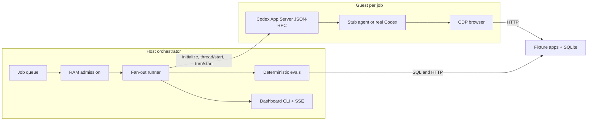

# Browser-use fan-out lab

Training lab for packaging **Codex App Server** inside a guest, fanning browser-use jobs out across those guests, and scoring them with deterministic checks. The lab assumes you already know why a microVM-per-user boundary exists. It does not build a VMM, and it is not a sandbox product.

This is **browser-use over CDP** (Lightpanda, or Playwright Chromium when that binary is absent). It is not screenshot-to-click desktop computer-use.

## How this differs from OpenShell

NVIDIA OpenShell is a sandbox product: it owns the isolation environment agents run in. This repo is an internal workshop. Isolation is a boundary you already have (microVM per user in production, a process or container per job in the lab). The material here is the stuff that sits on either side of that boundary:

- pin and launch `codex app-server` inside the guest
- give that guest a CDP browser (Lightpanda on `127.0.0.1:9222`)
- on the host, queue job cards, admit guests from a RAM budget, stream `thread/start` / `turn/start`, run evals, tear the guest down

No OpenShell dependency, no public-web scraping, no API key on the stub path.

## Architecture



| Piece | Role |
| --- | --- |
| `apps/fixtures` | Onboarding portal, support desk, booking app. SQLite, seed, `POST /api/reset`. |
| `packages/orchestrator` | Queue, RAM admission, fan-out runner, CLI + HTML/SSE dashboard. |
| `packages/guest-agent` | Mock app-server (`initialize`, `thread/start`, `turn/start`), CDP browser tool, scripted stub agent. |
| `packages/evals` | DB and HTTP checkers. No LLM judge. |
| `tasks/` | OSWorld-style job cards: goal, setup, executable eval. `batch-24.yaml` is the sample fan-out. |
| `drivers/process` | Default guest: one Node process per job, stdio JSON-RPC. |
| `drivers/docker` | Optional guest image skeleton (Debian, not Alpine). |
| `drivers/microvm` | Stub. Swap in libkrun or Virtualization.framework on a Mac. |

Production pattern: **one microVM per user**, and that VM contains Codex App Server. This fan-out lab runs **one guest per job** so a single machine can drain a queue of short browser tasks. See [docs/microvm.md](docs/microvm.md) and [docs/architecture.md](docs/architecture.md).

## Mac 24GB budget

Lightpanda guests are small. The defaults in `createDefaultConfig` match a 24GB Apple Silicon machine:

| | |
| --- | --- |
| Machine | 24 GB |
| Reserved for the host (OS, orchestrator, fixtures, dashboard) | 6 GB |
| Left for guests | 18 GB |
| Per Lightpanda guest | 700 MB (the 600–800 MB band) |
| Memory-only ceiling | `floor(18432 / 700) = 26` |
| Lab cap you should actually set | **20–24** concurrent guests |

```bash
./scripts/run-demo.sh --concurrency 20
```

That flag does not require Mac hardware. Here, guests are processes, so do not actually start 20 Chromium instances on a small VM. Use the low-RAM flag instead. It sets a 2000 MB budget and a 600 MB host reserve, which admits **2** guests of 700 MB and leaves the other 22 jobs queued:

```bash
./scripts/run-demo.sh --low-ram --exit
```

The summary prints `peak concurrent guests` and `backpressure events`. Unit tests lock the same math.

## Run the demo

Stub mode is the default. It does not need OpenAI credentials, a Codex binary, or Lightpanda.

```bash
./scripts/bootstrap.sh
./scripts/run-demo.sh --low-ram --exit
```

What that does:

1. Starts the fixture server on [http://127.0.0.1:4317](http://127.0.0.1:4317) if it is not already up.
2. `POST /api/reset` so every run sees the same venues, tickets, and empty users.
3. Enqueues the 24 job cards in `tasks/batch-24.yaml`.
4. Admits guests up to the RAM cap. Each guest is a process speaking the app-server JSON-RPC subset. The stub drives Playwright Chromium (or Lightpanda if you point it at a CDP endpoint).
5. Scores each job against SQLite and the fixture HTTP API.
6. Prints pass/fail, queue stats, peak concurrency, and backpressure. The HTML dashboard is [http://127.0.0.1:4318](http://127.0.0.1:4318) (`/events` is SSE, `/` is the live page). Add `--exit` to stop when the queue drains; omit it to leave the dashboard serving.

Useful slices:

```bash
./scripts/run-demo.sh --jobs onboarding-001,support-001,booking-008 --exit
./scripts/run-demo.sh --browser lightpanda --exit          # falls back to Chromium unless Lightpanda is actually up
./scripts/run-demo.sh --app-server real --exit             # spawns `codex app-server` instead of the mock; needs a pinned binary
./scripts/reset-fixtures.sh
pnpm test
```

## Task packs

Job cards live in `tasks/*.yaml`. A pass is a row, a joined query, or a JSON API body. Nothing is graded by a model.

| Pack | Pass condition |
| --- | --- |
| Portal onboarding | User row for that persona (name, plan, terms timestamp), a session row, a `welcome-guide.pdf` download row. |
| Ticket triage | Status, tags, assignee, and reply body match the gold values on that `ticket_id`. |
| Constrained booking | Reservation for that guest matches date, party size, accessibility, and `price_per_hour`. |

`booking-008` loads a slot, marks it sold out, submits, gets `slot_unavailable`, backs off, and books the next slot that still satisfies the constraints. The host queue is the other backoff: jobs sit in the queue while admission is closed.

## Real Codex and real microVMs

- [docs/codex-app-server.md](docs/codex-app-server.md) — pin `codex app-server`, the JSON-RPC messages the mock implements, `--app-server real`.
- [docs/lightpanda.md](docs/lightpanda.md) — glibc guest, `LIGHTPANDA_DISABLE_TELEMETRY=true`, CDP on 9222, Chromium fallback.
- [docs/microvm.md](docs/microvm.md) — process vs docker vs libkrun / Virtualization.framework.
- [docs/demo-script.md](docs/demo-script.md) — 30–45 minute walkthrough.
- [docs/lab-brief.md](docs/lab-brief.md) — one-page brief.

## Layout

```
apps/fixtures/          three portals + SQLite
packages/orchestrator/  queue, admission, runner, dashboard
packages/guest-agent/   mock app-server, browser tool, stub agent
packages/evals/         deterministic checkers
tasks/                  job cards + batch-24
drivers/                process (default), docker, microvm stub
scripts/                bootstrap, run-demo, reset-fixtures
docs/                   workshop writeups
```

## Tests

`pnpm test` covers admission math, the fan-out cap under a 2-guest budget, and the DB/API checkers. No Mac, no paid API, no browser download. The demo command is the end-to-end check.
