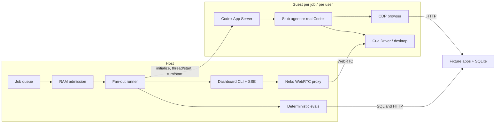

# Build your own Grokbot/Dots — MicroVM Workshop

A local workshop for building the two halves of a user-owned agent:

1. **The agent desktop** — a per-user Linux desktop with Codex and a computer-use driver inside it, streamed to your own dashboard. This is the Grokbot/Dots-shaped part: your model, your machine, your infrastructure.
2. **The fan-out lab** — a host queue that admits guests under a RAM budget, drives many short browser-use jobs through Codex App Server JSON-RPC, scores them with deterministic checks, and shows backpressure while the queue drains.

It is an internal training asset, not a competing sandbox product. It assumes you already know why a microVM-per-user boundary exists. It does **not** build a VMM.

## Status at a glance

| Original goal | Status |
| --- | --- |
| README with architecture, Mac budgeting, OpenShell comparison, demo path | ✅ this document |
| One scripted path: fixtures → queue → stub agents → CDP/Chromium → pass/fail + queue metrics | ✅ verified 24/24; peak 2, 22 backpressure events under `--low-ram` |
| Onboarding, support, and booking packs with deterministic evals | ✅ verified 24/24 in stub mode |
| Admission control limits concurrency under a low RAM budget | ✅ unit-tested; low-RAM run admits 2 guests |
| CI-friendly tests with no Mac, VMM, or paid API | ✅ `pnpm test` (40 tests) |
| Extension points for real Codex App Server and real microVMs | ✅ `--app-server real`, `drivers/lume`, `drivers/docker` |
| Lightpanda CDP with documented Chromium fallback | ✅ implemented; Chromium is the default lab browser |
| Local Grokbot/Dots-style desktop with Codex inside | ✅ neko + WebRTC + Cua Driver + two desks |
| OSWorld-style desktop tasks | ✅ optional QEMU/lume wall, separate from the browser fan-out |

The happy-path stub demo needs no OpenAI key. The Codex desk demo uses the host Codex login described below.

## Quickstart

### 1. Host fan-out, no API key

```bash
./scripts/bootstrap.sh
./scripts/run-demo.sh --driver process --low-ram --exit
```

That starts the fixture server on [http://127.0.0.1:4317](http://127.0.0.1:4317), resets SQLite, enqueues `tasks/batch-24.yaml`, runs stub agents over Playwright Chromium, scores SQL/HTTP checks, and prints:

- pass/fail per job
- queue depth and queue stats
- peak concurrent guests
- backpressure events

For a fast smoke test:

```bash
./scripts/run-demo.sh --driver process \
  --jobs onboarding-001,support-001,booking-008 \
  --exit
```

### 2. Local agent desktop, WebRTC, Codex in the container

Requires Podman or Docker. On this Mac the tested path is Podman.

```bash
podman build -t workshop-neko:desk -f drivers/docker/Dockerfile .
DOCKER_BIN=podman ./scripts/boot-neko.sh
```

`boot-neko.sh` starts **two** neko desks by default:

| Container | Default app | Dashboard |
| --- | --- | --- |
| `workshop-neko` | fixture index | `/neko/workshop-neko/` |
| `workshop-neko-2` | Support Desk | `/neko/workshop-neko-2/` |

Open the dashboard:

- [http://127.0.0.1:4318](http://127.0.0.1:4318) — desk + Codex chat
- [http://127.0.0.1:4318/vms](http://127.0.0.1:4318/vms) — both WebRTC desktops
- [http://127.0.0.1:4318/neko/workshop-neko/](http://127.0.0.1:4318/neko/workshop-neko/) — primary stream through the dashboard proxy

The desk chat runs `codex app-server` **inside** the neko container and drives the container's Cua Driver. Codex credentials are copied from the host into the container for each turn:

```text
CODEX_AUTH_JSON, or ~/.codex/auth.json → /home/neko/.codex/auth.json
```

Set `CODEX_DESK=0` to keep the local phrase planner and skip model turns.

To open the fixture apps in the container and capture screenshots:

```bash
./scripts/demo-fixtures.sh
# runs/shots/workshop-index.png
# runs/shots/workshop-onboarding.png
# runs/shots/workshop-support.png
# runs/shots/workshop-booking.png
```

The desktop also has a **MicroVM Workshop** launcher that opens the fixture index in container Firefox.

## Architecture



Production shape: **one microVM per user**, with Codex App Server inside it. This lab runs **one guest per job** so a single machine can drain a queue of short tasks. The neko desk is a local, persistent guest for the agent-desktop half.

| Piece | Role |
| --- | --- |
| `apps/fixtures` | Onboarding, support desk, booking app. SQLite, seed, `POST /api/reset`. |
| `packages/orchestrator` | Queue, RAM admission, fan-out runner, CLI + HTML/SSE dashboard. |
| `packages/guest-agent` | Mock App Server (`initialize`, `thread/start`, `turn/start`), CDP browser tool, stub agent, `exec-server` shim. |
| `packages/evals` | DB, HTTP, cookie, URL, and ODS checkers. No LLM judge. |
| `tasks/` | Job cards and executable evals. `batch-24.yaml` is the browser fan-out. |
| `packages/agents-api` | Local Agents API: self-hosted sessions, signed webhooks, executor WebSocket. |
| `drivers/process` | Fast path: one Node process per job, stdio JSON-RPC. |
| `drivers/lume` | Default VM driver. `lume` on Apple Silicon; QEMU on Linux. |
| `drivers/docker` | Neko guest. One container per Agents API session, plus the standing desks. |
| `drivers/microvm` | Alias of the lume/QEMU driver. |

## How this differs from NVIDIA OpenShell

OpenShell is a sandbox product: it owns the isolation environment agents run in. This repo is a workshop about the material on either side of that boundary:

- pin and launch `codex app-server` inside the guest
- give the guest a CDP browser (Lightpanda on `127.0.0.1:9222`, or the Chromium fallback)
- run a user-owned desktop with Codex + Cua Driver inside the container
- on the host, queue job cards, admit guests from a RAM budget, stream `thread/start` / `turn/start`, run evals, and tear the guest down

There is no OpenShell dependency, no public-web scraping as the primary demo, and no API key on the stub path.

## Mac 24GB budget

The defaults in `createDefaultConfig` match a 24GB Apple Silicon machine:

| | |
| --- | --- |
| Machine | 24 GB |
| Reserved for the host (OS, orchestrator, fixtures, dashboard) | 6 GB |
| Left for guests | 18 GB |
| Per Lightpanda guest | 700 MB (the 600–800 MB band) |
| Memory-only ceiling | `floor(18432 / 700) = 26` |
| Lab cap you should actually set | **20–24** concurrent guests |

That is the arithmetic, not a command to launch 20 Chromium instances. Chromium is heavier than Lightpanda. The low-RAM flag sets a 2000 MB budget and a 600 MB host reserve, which admits **2** guests of 700 MB and leaves the rest queued:

```bash
./scripts/run-demo.sh --driver process --low-ram --exit
```

The summary prints `peak concurrent guests` and `backpressure events`. Unit tests lock the same math.

## The desktop half: Grokbot/Dots locally

The neko desks are the local agent-desktop artifact. Each container runs:

- Xfce on `DISPLAY=:99.0`
- Firefox ESR for the fixture apps
- Cua Driver as the `neko` user
- Codex CLI in `/opt/codex`, with `codex app-server`
- x11vnc as a VNC fallback
- neko's WebRTC stream

The dashboard proxies neko HTTP and WebSocket same-origin at `/neko/<container>/`, so the WebRTC client works through the dashboard port. Stock neko chrome is hidden; the dashboard owns the header, stream frame, **Take control** button, and chat.

The chat is SSE and shows:

- streamed assistant deltas
- collapsible reasoning summaries
- compact MCP tool-call chips
- active-window screenshots after input actions
- the container's live WebRTC desktop

`NEKO_IMPLICIT_CONTROL=true` and a visible **Take control** button make the stream directly usable without hunting for neko's tiny control icon.

OpenClaw is **optional**. If `/opt/openclaw` exists, `boot-neko.sh` starts the host gateway and a node per container; the dashboard then reports "OpenClaw node" for that desktop. Without it, the same desks work with the in-container Codex path.

## Docker / Podman on macOS

The image is self-contained: Linux Node 22, Playwright Chromium, pinned Codex `0.167.1` (including `codex-code-mode-host`), Cua Driver `0.47.5`, Firefox, AT-SPI, and x11vnc.

```bash
podman build -t workshop-neko:desk -f drivers/docker/Dockerfile .
DOCKER_BIN=podman ./scripts/boot-neko.sh
```

macOS uses published ports instead of `--network host`:

- `8341` / `5930` primary desk
- `8342` / `5931` secondary desk
- per-desk WebRTC UDP/TCP mux ports

For a per-job Docker evaluation:

```bash
DOCKER_BIN=podman \
AGENTS_PUBLIC_HOST=host.docker.internal \
./scripts/run-demo.sh --driver docker \
  --jobs onboarding-001,support-001,booking-008 \
  --concurrency 1 --exit
```

Inside the image, `/usr/local/bin/codex` is the real CLI. `/workspace/bin/codex` remains the lab `exec-server` shim; do not replace it.

The repo pins Node 22 through `.tool-versions`. Install the host Codex CLI into that same Node so the dashboard can spawn it:

```bash
npm install -g @openai/codex@0.167.1
codex --version
```

If Docker is available instead of Podman, use `DOCKER_BIN=docker`.

## Host fan-out demo

The default CLI driver is `lume`: a real guest VM plus the local Agents API control plane. It does not need an OpenAI key.

```bash
./scripts/bootstrap.sh
./scripts/build-guest-image.sh
./scripts/run-demo.sh --driver lume \
  --jobs onboarding-001,support-001,booking-008 \
  --concurrency 1 --exit
```

The 24-job fan-out is designed for the process driver:

```bash
./scripts/run-demo.sh --driver process --low-ram --exit
```

What happens:

1. Start fixtures on `http://127.0.0.1:4317` if needed.
2. `POST /api/reset` so every run sees the same venues, tickets, and empty users.
3. Enqueue the 24 cards from `tasks/batch-24.yaml`.
4. Admit guests up to the RAM cap.
   - `lume`: boot a VM, start `codex exec-server`, drive the stub against Chromium inside the guest.
   - `process`: skip the VM and speak App Server JSON-RPC to a local Node process.
   - `docker`: create a neko container per Agents API session.
5. Score against SQLite and fixture HTTP.
6. Print results, queue stats, peak concurrency, and backpressure.

Useful slices:

```bash
./scripts/run-demo.sh --driver process \
  --jobs onboarding-001,support-001,booking-008 --exit

./scripts/run-demo.sh --driver process --browser lightpanda --exit
# falls back to Chromium unless Lightpanda is actually up

ALLOW_CHROMIUM_FALLBACK=false ./scripts/run-demo.sh \
  --driver process --browser lightpanda --exit

./scripts/run-demo.sh --driver process --app-server real --exit
# spawns `codex app-server`; needs a pinned host binary

./scripts/reset-fixtures.sh
pnpm test
```

## Task packs

Job cards live in `tasks/*.yaml`. A pass is a row, a joined query, a file, a cookie, or a JSON API body. Nothing is graded by a model.

| Pack | Pass condition |
| --- | --- |
| Portal onboarding | User row for the persona (name, plan, terms timestamp), a session row, and a `welcome-guide.pdf` download row. |
| Ticket triage | Status, tags, assignee, and reply body match the gold values on that `ticket_id`. |
| Constrained booking | Reservation for the guest matches date, party size, accessibility, and `price_per_hour`. |
| OSWorld Calc | ODS uploaded by the guest. Formulas, cached values, frozen header, and currency/percent styles match `tasks/osworld/calc-*.json`. |
| OSWorld Chrome | The same fixture gold, driven in headed Chrome on the guest desktop. |
| OSWorld workflow | One guest does Chrome (GDPR ticket) then Calc (invoice). |

`booking-008` loads a slot, marks it sold out, submits, sees `slot_unavailable`, backs off, and books the next valid slot. The host queue is the other backoff: jobs wait while admission is closed.

The OSWorld wall is optional. It runs three Chrome tasks and three Calc tasks, alternating, then `flow-triage` when RAM remains. Guests are QEMU TCG on Linux (`boot-osworld-wall.sh`); a Mac uses `lume` / Virtualization.framework. The wall is separate from the browser-use fan-out and from the WebRTC desk.

## Real Codex and real microVMs

- **Process driver, real App Server:** `--app-server real` or `CODEX_BIN=/path/to/codex`.
- **Neko desk:** Codex `0.167.1` is installed in the image and runs inside the container; the dashboard copies host auth per turn.
- **Lume / QEMU guests:** `codex exec-server` with the local Agents API lifecycle.
- **Lab `exec-server` shim:** `bin/codex`; it speaks the lab's small JSON command channel, not the real Noise relay. Do not overwrite it.
- **Lightpanda:** glibc guest, `LIGHTPANDA_DISABLE_TELEMETRY=true`, CDP on `127.0.0.1:9222`. Chromium is the documented fallback and the default lab browser. This is **browser-use over CDP**, not the OSWorld screenshot→click loop for the fan-out packs.

Docs:

- [docs/codex-app-server.md](docs/codex-app-server.md) — pin `codex app-server`, JSON-RPC handshake, mock vs real.
- [docs/lightpanda.md](docs/lightpanda.md) — glibc, CDP, telemetry, Chromium fallback.
- [docs/agents-api.md](docs/agents-api.md) — sessions, webhooks, `codex exec-server`.
- [docs/microvm.md](docs/microvm.md) — lume / Virtualization.framework, QEMU, Docker.
- [docs/architecture.md](docs/architecture.md) — control loop.
- [docs/demo-script.md](docs/demo-script.md) — 30–45 minute walkthrough.
- [docs/lab-brief.md](docs/lab-brief.md) — one-page brief.

## Tests and CI

```bash
pnpm install
pnpm test
pnpm run typecheck
```

Covered:

- admission math and the fan-out cap under a 2-guest budget
- DB/API/ODS checkers
- webhook signatures and Agents API lifecycle
- docker neko container arguments
- wall-turn stub behavior

No Mac, VMM, browser binary in CI, or paid API is required for the test suite.

## Non-goals

- Do not build a full VMM.
- Do not depend on NVIDIA OpenShell.
- Do not make public-web scraping the primary demo.
- Do not require secrets for the stub happy path.
- Do not grade tasks with an LLM.
- Do not pretend the Docker neko driver is a generic microVM replacement.

## Layout

```text
apps/fixtures/            three portals + SQLite + seed/reset
packages/orchestrator/    queue, admission, runner, dashboard
packages/guest-agent/     mock app-server, browser tool, stub agent, exec-server
packages/agents-api/      local Agents API control plane
packages/evals/           deterministic checkers
tasks/                    job cards, batch-24, OSWorld packs
drivers/                  process, lume, docker/neko, microvm alias
scripts/                  bootstrap, run-demo, boot-neko, demo-fixtures
scripts/neko/             desk image helpers, Cua wrapper, OpenClaw node
.codex/config.toml        optional host-side Codex MCP registration
```
