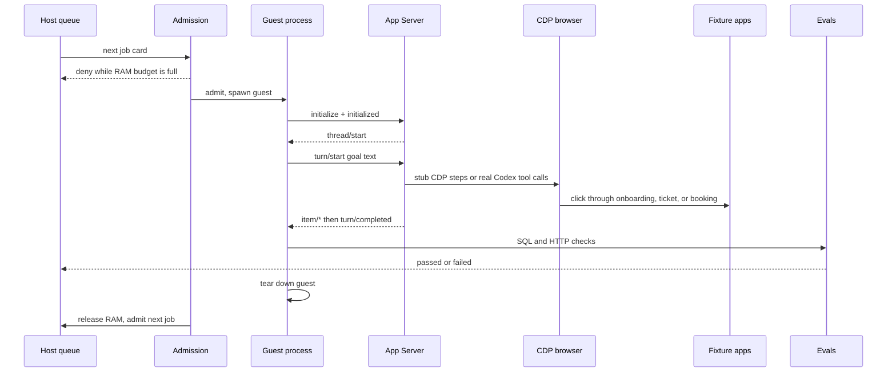

# Architecture

Browser-use over CDP, with the host owning the queue and the guest owning the agent and the browser.

## Host

`WorkQueue` holds job cards. `MemoryController` admits a guest only when both of these are true:

- active guests < `max_concurrent_guests`
- free guest RAM >= `memory_per_guest_mb`

Free guest RAM is `total_memory_budget_mb - reserved_host_memory_mb - used`. On a 24 GB Mac that is 6 GB reserved and ~700 MB per Lightpanda guest, so 20–24 in flight is the operating point (`floor((24576-6144)/700) = 26` is the hard memory ceiling).

`FanOutRunner.pump` starts as many admitted jobs as the budget allows and listens for `guest:released` before starting more. A denial while the queue is non-empty is a backpressure event. There is no thread pool hidden under the budget.

Evals run on the host after the turn, against the fixture SQLite file and HTTP API. The guest does not grade itself.

## Guest

`drivers/process` spawns `packages/guest-agent/src/worker.ts` with stdio JSON-RPC, same shape Codex uses (no `jsonrpc` field on the wire):

1. `initialize` / `initialized`
2. `thread/start` → `{ thread: { id, ephemeral } }` and a `thread/started` notification
3. `turn/start` with `threadId` and `input: [{ type: "text", text }]` returns immediately with `status: "inProgress"`
4. notifications: `turn/started`, `item/completed`, `turn/completed`

The mock runs the stub agent. `--app-server real` spawns `codex app-server` with the same client calls. The real binary will not pass these browser evals until the guest image also exposes a CDP browser tool to Codex. That wiring is the extension point, not the happy path.

Each stub turn launches its own browser. Default is Playwright Chromium with `--no-sandbox`. `--browser lightpanda` connects over CDP and falls back to Chromium unless `ALLOW_CHROMIUM_FALLBACK=false`.

## Fixtures

One Express process, three apps, one SQLite database (`apps/fixtures/data/fixtures.db`):

- `/onboarding` signup → plan → terms → welcome → PDF download
- `/support` ticket list and detail
- `/booking` filter, slot, guest form, confirmation

`POST /api/reset` wipes and reseeds. Venue ids and slot ids are fixed. Every slot starts available, so evals do not depend on `Math.random`.

## Why process guests in this repo

A microVM is the production boundary (one per user). Linux CI and this workspace have no Mac hypervisor. The process driver is the same control loop: admit, stdio RPC, CDP, eval, kill. Docker and microVM drivers are the swap points (`drivers/docker`, `drivers/microvm`).
